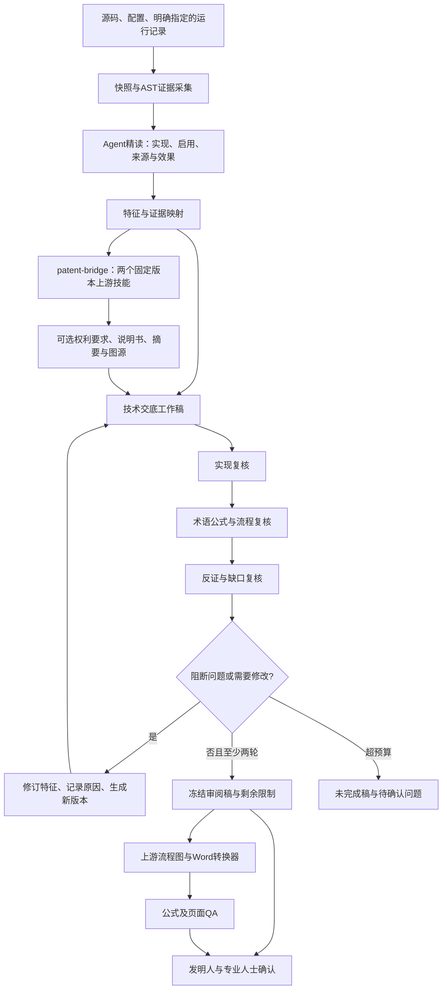

# 从实现证据到审阅稿

模型端负责理解与写作；工具端负责记录与约束。Agent可根据复核问题调整下一步，默认按同一Agent的多视角串行工作，不要求多Agent并行、不自动联网调用模型。

交底与申请文件在同一manifest内冻结；申请review绑定全部文件哈希。Word由固定版本转换器处理，产出待页面核查的候选，失败图或公式不隐去。来源/许可证保留在vendor及THIRD_PARTY_NOTICES中。

区别于“论文改成专利”的地方：必须追到代码定义、调用入口、配置开关和具体数据流；技术方案按实现闭环建立，不把论文贡献列表或专利原稿当最终事实。公式与技术效果仍需实际核查，AST不替代技术判断。
